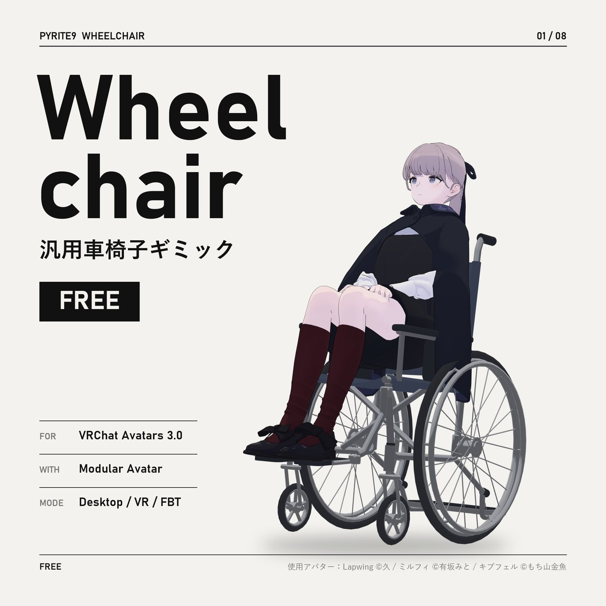
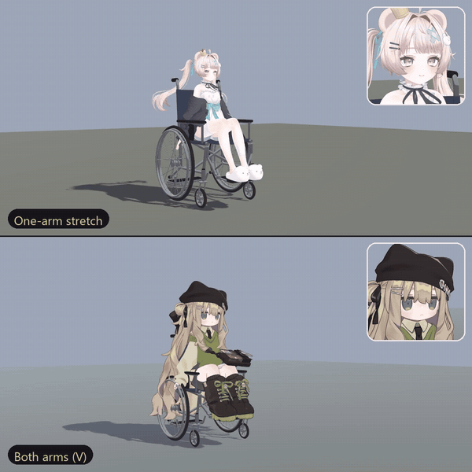
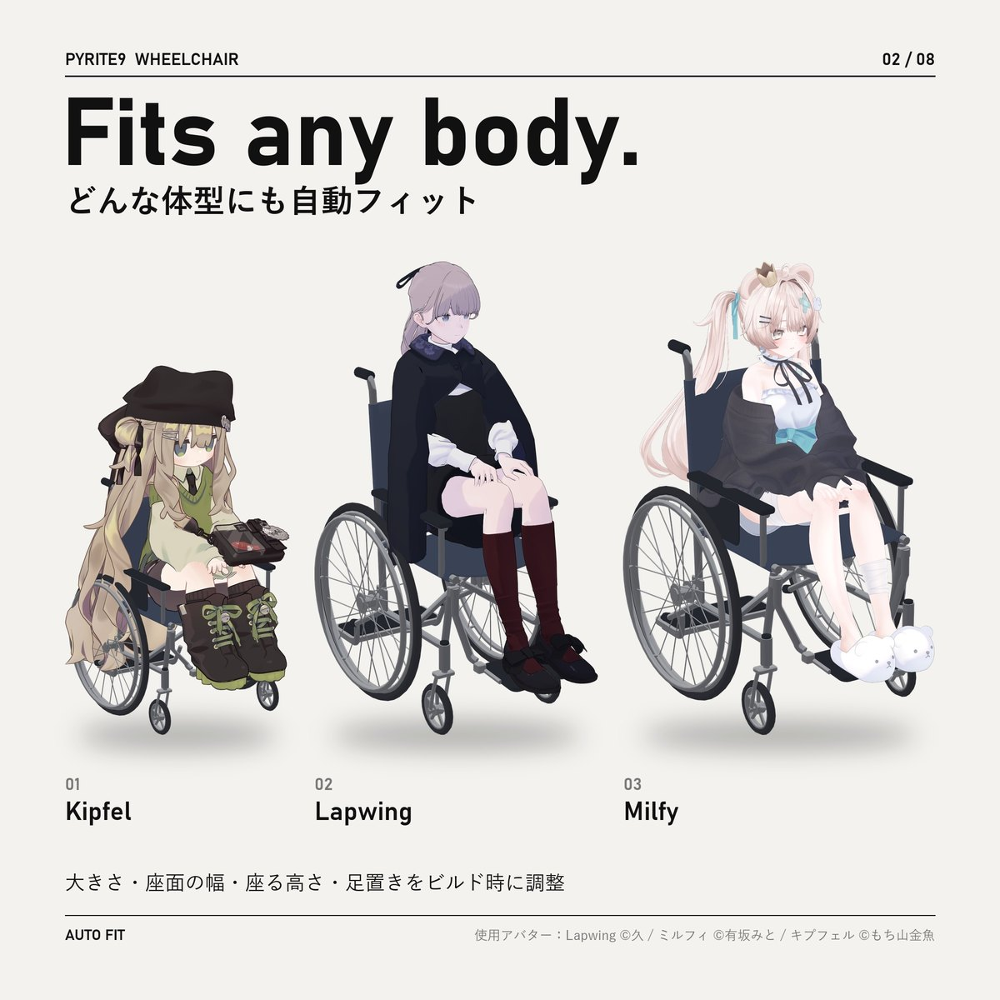
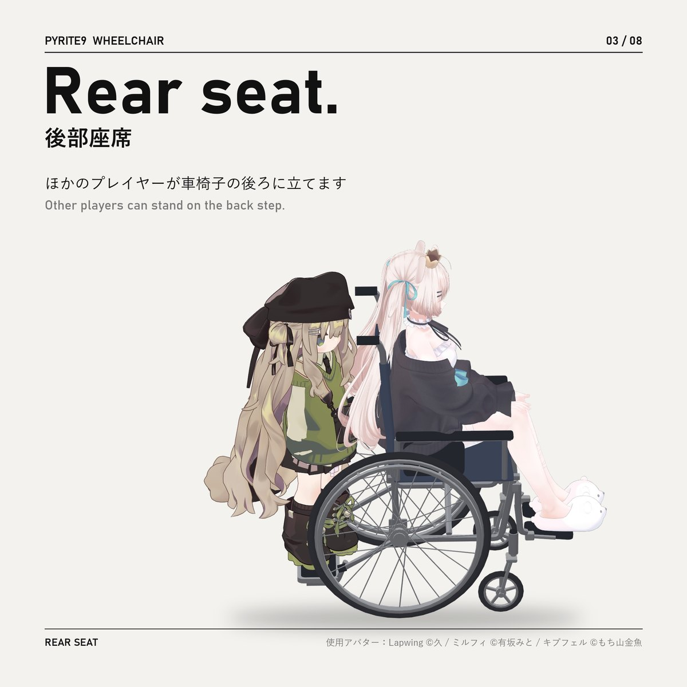
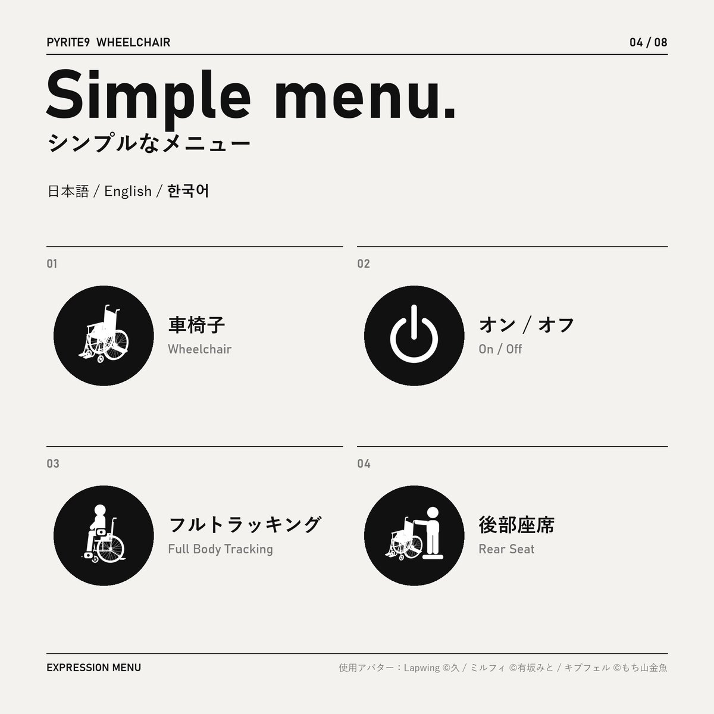
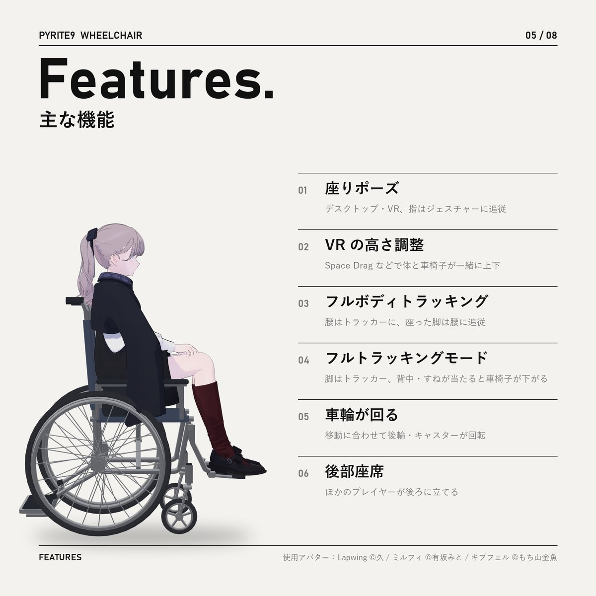
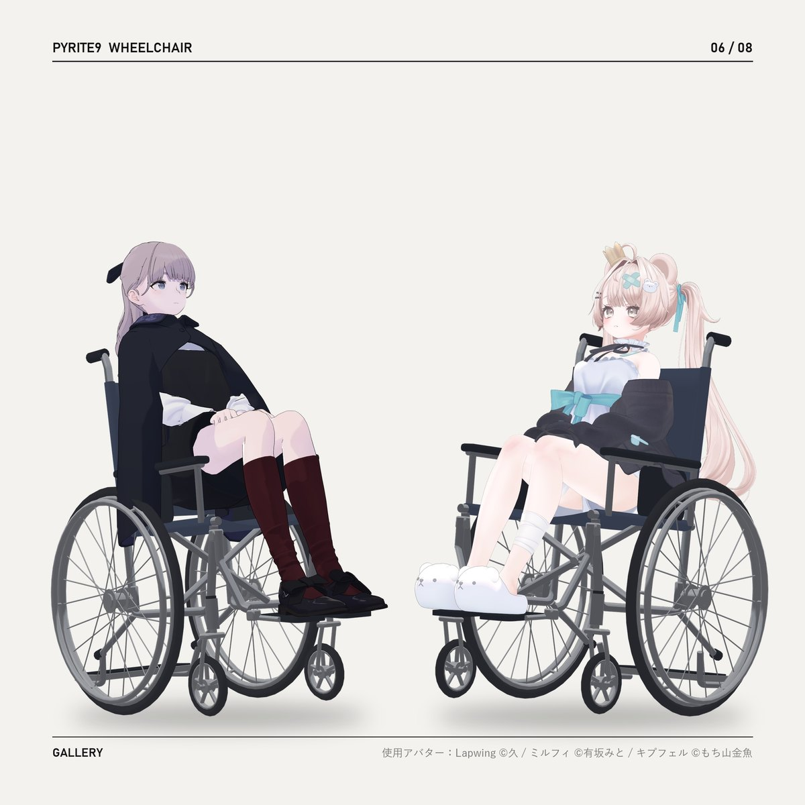
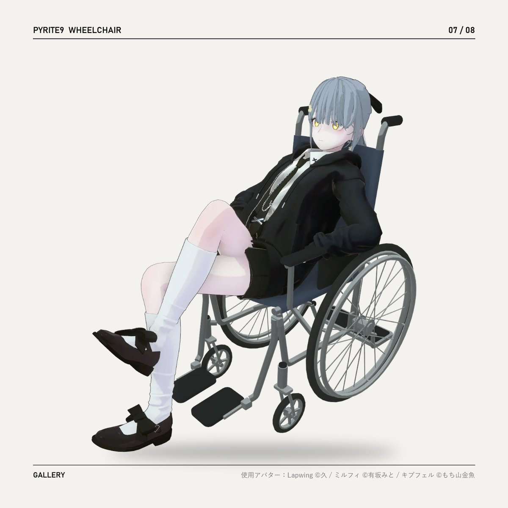
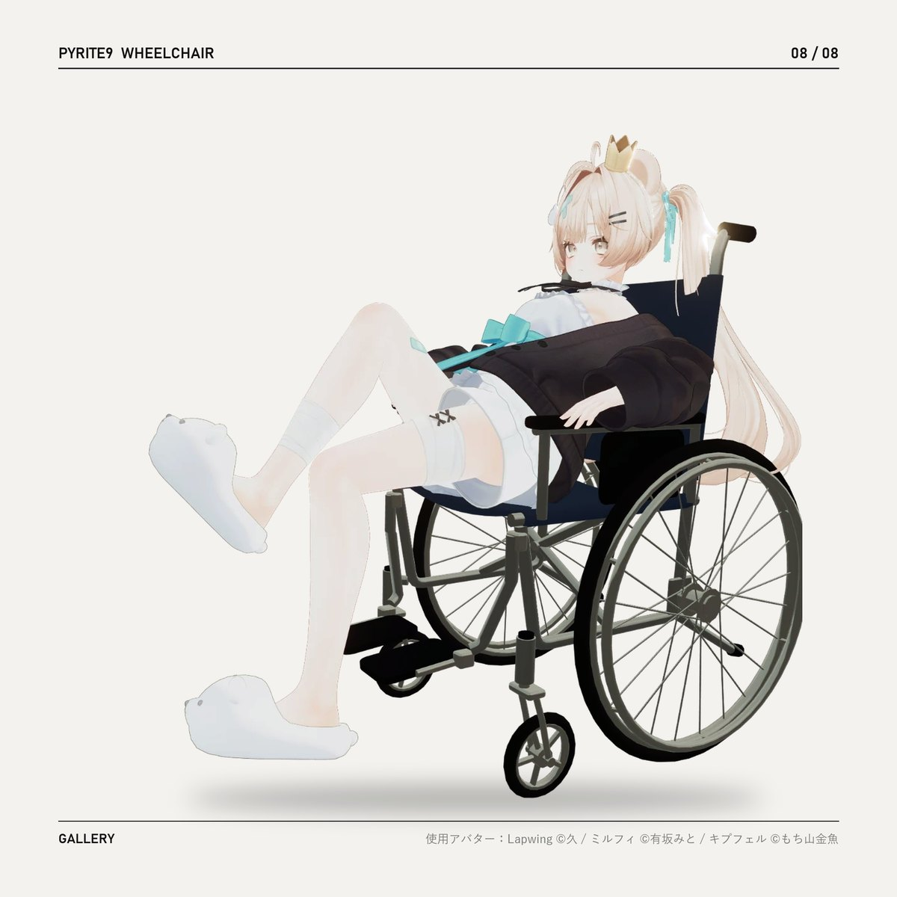

  

<h1 align="center">Wheelchair</h1>

  <b>汎用車椅子ギミック</b> · Wheelchair gimmick for VRChat · VRChat 범용 휠체어 기믹 
  <b>FREE / 無料 / 무료</b> — Modular Avatar · Desktop / VR / FBT

  <a href="https://pyrite9.booth.pm/items/9004771"><b>BOOTH</b></a> ·
  <a href="../../releases/latest"><b>Download (Releases)</b></a> ·
  <a href="Assets/Pyrite9/Wheelchair/README_jp.md">日本語</a> ·
  <a href="Assets/Pyrite9/Wheelchair/README_en.md">English</a> ·
  <a href="Assets/Pyrite9/Wheelchair/README_ko.md">한국어</a>

---

## What's new in 1.1.0 · 1.1.1 / 1.1.0・1.1.1 の新機能 / 1.1.0·1.1.1 새 기능

- **1.1.1：不具合修正 / Bug fix / 버그 수정** — 車椅子を入れるだけでアバターの表情が固まる（元に戻らない）不具合を直しました。1.1.0 で AFK Motion をオフにして回避していた方は、オンに戻して大丈夫です。Light Limit Changer を使っているアバターで、AFK の消える演出中に服の色が変わる不具合も直しました  
  Fixed the avatar's facial expressions getting stuck (not going back to neutral) just by adding the wheelchair in 1.1.0. If you turned AFK Motion off to work around it, you can turn it back on. Also fixed clothing colors changing during the AFK fade on avatars that use Light Limit Changer.  
  1.1.0에서 휠체어를 넣기만 해도 아바타 표정이 굳던(원래대로 안 돌아오던) 것을 고쳤습니다. 피하려고 AFK Motion을 꺼 두셨다면 다시 켜셔도 됩니다. Light Limit Changer를 쓰는 아바타에서 AFK로 사라지는 동안 옷 색이 바뀌던 것도 고쳤습니다
- **座ったまま AFK モーション** — AFK になると立ち上がって伸びをし、歩きながら消えます。戻ると現れて座り直します。ビルド時にアバターごとに自動で作成（設定不要）、表情はアバターのまぶた・リップシンクのシェイプキーを使います。フルトラッキングモードでも動きます  
  **AFK motion while seated** — when you go AFK you stand up, stretch, walk away and disappear; when you return you reappear and sit back down. Made for each avatar at build time (no setup); the face uses your avatar's eyelid and lip-sync blend shapes. Works in Full Body Tracking mode too.  
  **앉은 채 AFK 모션** — AFK가 되면 일어나 기지개를 켜고 걸어가며 사라지고, 돌아오면 다시 나타나 앉습니다. 빌드할 때 아바타마다 자동으로 만듭니다(설정 없음). 표정은 아바타의 눈꺼풀·립싱크 셰이프키를 씁니다. 풀 트래킹 모드에서도 동작합니다
- **AFK の設定（インスペクター）** — モーション：オフ・自動・片腕・両腕 / 消え方：ディゾルブ・即時  
  **AFK settings (inspector)** — Motion: Off / Auto / One-arm / Both arms · Vanish: Dissolve / Instant  
  **AFK 설정(인스펙터)** — 모션: 끔·자동·한쪽·양팔 / 사라지기: 디졸브·즉시
- **1.0.2 から / Since 1.0.2 / 1.0.2부터** — Space Drag の不具合修正（アバターの大きさに関係なく）· 新しいインスペクター（Unity 内で座った姿をプレビュー・最後のビルド・最新版のお知らせ）  
  Space Drag bug fix (works at any avatar scale) · new inspector (sitting preview in Unity, last build summary, update notice)  
  Space Drag 버그 수정(아바타 크기와 상관없이) · 새 인스펙터(Unity 안 앉은 모습 미리보기·마지막 빌드·최신 버전 알림)

Full changelog: [日本語](Assets/Pyrite9/Wheelchair/README_jp.md) · [English](Assets/Pyrite9/Wheelchair/README_en.md#changelog) · [한국어](Assets/Pyrite9/Wheelchair/README_ko.md)

---

`02 / 08`

## Fits any body.

どんな体型にも自動フィット — 大きさ・座面の幅・座る高さ・足置きをビルド時に調整  
Fits itself to any humanoid avatar at build time — size, seat width, sitting height and footrests.  
어떤 체형에도 자동으로 맞춤 — 크기·좌석 폭·앉는 높이·발판을 빌드할 때 조정

---

`03 / 08`

## Rear seat.

後部座席 — ほかのプレイヤーが車椅子の後ろに立てます  
Other players can stand on the back step.  
뒷좌석 — 다른 플레이어가 휠체어 뒤 발판에 설 수 있습니다

---

`04 / 08`

## Simple menu.

シンプルなメニュー — 日本語 / English / 한국어  
Expression Menu: Wheelchair · On / Off · Full Body Tracking · Rear Seat  
간단한 메뉴 — 휠체어 · 켜기/끄기 · 풀 트래킹 · 뒷좌석

---

`05 / 08`

## Features.

| | 日本語 | English | 한국어 |
|---|---|---|---|
| 01 | 座りポーズ（指はジェスチャーに追従） | Sitting pose for desktop and VR (fingers follow gestures) | 데스크톱·VR 앉기 자세(손가락은 제스처를 따라감) |
| 02 | VR の高さ調整（Space Drag などで体と車椅子が一緒に上下・アバターの大きさに関係なく） | VR height: a playspace mover (e.g. Space Drag) moves body and chair together, at any avatar scale | VR 높이: Space Drag 등으로 몸과 휠체어가 함께 위아래로(아바타 크기와 상관없이) |
| 03 | フルボディトラッキング（腰はトラッカー、座った脚は腰に追従） | Full-body tracking: hips follow the tracker, seated legs follow the hips | 풀바디 트래킹: 골반은 트래커, 앉은 다리는 골반을 따라감 |
| 04 | フルトラッキングモード（背中・すねが当たると車椅子が下がる） | Full Body Tracking mode: the chair moves back when your back or shins push it | 풀 트래킹 모드: 등·정강이가 닿으면 휠체어가 뒤로 물러남 |
| 05 | 移動に合わせて後輪・キャスターが回転 | Rear wheels and casters spin as you move | 이동에 맞춰 뒷바퀴·캐스터가 회전 |
| 06 | 後部座席 | Rear Seat for other players | 뒷좌석 |
| 07 | 座ったまま AFK モーション（立ち上がって伸び・歩いて消える、戻ると座り直す — ビルド時にアバターごとに作成、オフ・自動・片腕・両腕 / ディゾルブ・即時） | AFK motion while seated: stand up, stretch, walk away and disappear; sit back down when you return (made for each avatar at build time; Off / Auto / One-arm / Both arms, Dissolve / Instant) | 앉은 채 AFK 모션: 일어나 기지개 켜고 걸어가 사라짐, 돌아오면 다시 앉음(빌드 때 아바타마다 만듦, 끔·자동·한쪽·양팔 / 디졸브·즉시) |
| 08 | インスペクター（座った姿のプレビュー・最後のビルド・新バージョンのお知らせ） | Inspector: sitting preview, last build summary, update notice | 인스펙터: 앉은 모습 미리보기·마지막 빌드·새 버전 알림 |

---

`06 – 08 / 08`

## Gallery.

  
  
  

---

## Install. / 導入 / 설치

1. VCC / ALCOM で **Modular Avatar** と **lilToon** を追加 · Add Modular Avatar and lilToon · Modular Avatar와 lilToon 추가
2. `Pyrite9_Wheelchair_v*.unitypackage` をインポート · Import the unitypackage · unitypackage 임포트
   (or copy `Assets/Pyrite9/Wheelchair/` from this repository with the `.meta` files)
3. `Assets/Pyrite9/Wheelchair/Wheelchair.prefab` をアバターへドラッグ · Drag the prefab onto your avatar · 프리팹을 아바타 위로 드래그
4. Build & Test → Build & Publish

## Requirements. / 動作環境 / 필요한 것

PC only · Unity 2022.3 · VRChat SDK Avatars 3.x · Modular Avatar (NDMF) · lilToon · humanoid avatar  
Tested: Unity 2022.3.22f1 / VRChat SDK 3.10.5 / Modular Avatar 1.18.7 / NDMF 1.14.8 / lilToon 2.3.4  
The inspector checks GitHub (`api.github.com`) for the latest version once a day; nothing is sent. · インスペクターは 1 日 1 回 GitHub で最新版を確認します（送信する情報はありません）· 인스펙터는 하루 한 번 GitHub에서 최신 버전을 확인합니다(보내는 정보 없음)

## License. / 利用規約 / 라이선스

Free — not an open-source license. See [LICENSE.txt](LICENSE.txt) (English / 日本語 / 한국어).  
Avatars using it (public or private) and monetized videos / streams are fine. Viewing and forking on GitHub are fine; redistributing the files elsewhere is not.  
無料。アバターへの使用・収益化を含む動画/配信 OK。GitHub での閲覧・フォーク可、それ以外での再配布は不可。  
무료. 아바타 사용·수익 창출 포함 영상/방송 OK. GitHub에서 보기·포크 가능, 그 밖의 재배포는 불가.

使用アバター（画像）: Lapwing ©久 / ミルフィ ©有坂みと / キプフェル ©もち山金魚

© Pyrite9

